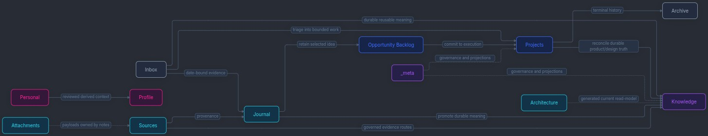

# Hypershell Mermaid for Obsidian

A reusable semantic Mermaid stylesheet for Obsidian with a restrained dark palette, color-coded diagram nodes, subtle edge-label chips, and consistent presentation in the regular Markdown preview and Mermaid Canvas fullscreen.

## Preview



## Installation

1. Copy [`hypershell-mermaid.css`](hypershell-mermaid.css) into your Obsidian vault's `.obsidian/snippets/` directory.
2. Enable **Hypershell Mermaid** in **Settings → Appearance → CSS snippets**.
3. Use semantic node classes in your authored Mermaid diagrams. The stylesheet has dark and light palette tokens.

## Example

```text
flowchart LR
    Inbox["Inbox"] -->|triage| Projects["Projects"]
    Projects -->|durable knowledge| Knowledge["Knowledge"]
    Sources["Sources"] -->|evidence| Knowledge

    class Inbox hs-neutral
    class Projects hs-primary
    class Knowledge hs-secondary
    class Sources hs-technical
```

Available semantic node classes: `hs-neutral`, `hs-primary`, `hs-secondary`, `hs-accent`, `hs-technical`, `hs-success`, `hs-warning`, and `hs-error`. Reserve success, warning, and error for actual status, not decoration.

## Compatibility and caveats

- Developed with Obsidian 1.13.7, the Minimal theme, and Mermaid Canvas 0.1.3.
- Mermaid Canvas fullscreen re-parents the diagram outside the Markdown preview. Both scopes are styled.
- The dark-mode SVG inversion filter used by some theme configurations is suppressed only for flowcharts with `hs-*` node classes.
- The stylesheet targets Mermaid's HTML `foreignObject` edge labels. Mermaid controls the label layout and line breaks; longer labels may wrap.
- Screenshot shows the Hypershell vault's public-safe information-flow example, not a starter vault or bundled note.
- Designed as a self-contained CSS snippet; no plugin patching or custom JavaScript is required.

## Customization

Colors are defined in the top-level `.theme-dark` and `.theme-light` CSS variables. Edge line and label-chip colors are separately adjustable; the shared node classes keep content semantics distinct from presentation.

## License

[MIT](../../../LICENSE).
